<p align="center"></p>
<h1 align="center">Pocket Wardrobe</h1>
<p align="center">Your clothes in one place, with photos — the AI reads a photo for you (what it is, its colours, how warm and how smart). Then: what goes with what for <i>your</i> style, today's outfit for the weather and what is on your calendar, what you wore and when, the laundry and the tailor, what to pack for a trip, and what is worth buying — drawn, with how many new outfits it would make and those outfits, before you spend a cent.<br>One Go binary, one SQLite file, one volume. Part of the Pocket apps; works on its own too.</p>
<p align="center">
  <a href="https://github.com/abjelosevic88/pocket-homelab-wardrobe/actions"></a>
  <a href="https://github.com/abjelosevic88/pocket-homelab-wardrobe/pkgs/container/pocket-homelab-wardrobe"></a>
  <a href="LICENSE"></a>
</p>

---

<p align="center">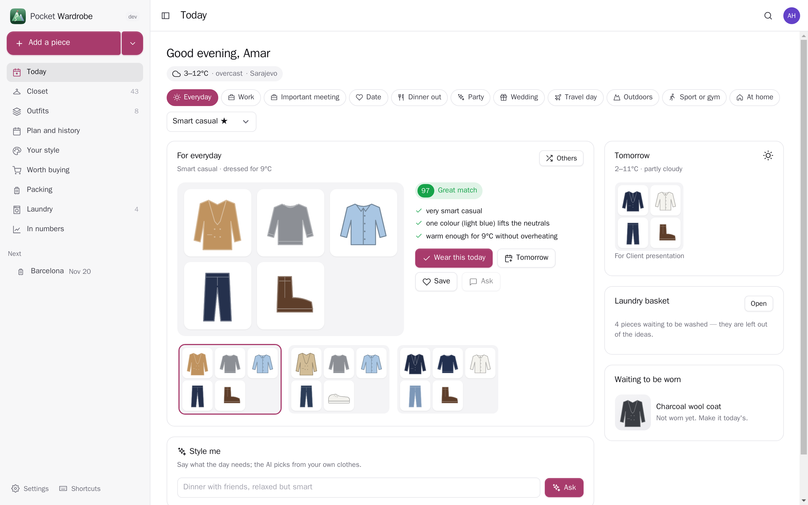</p>

<table>
  <tr>
    <td width="50%">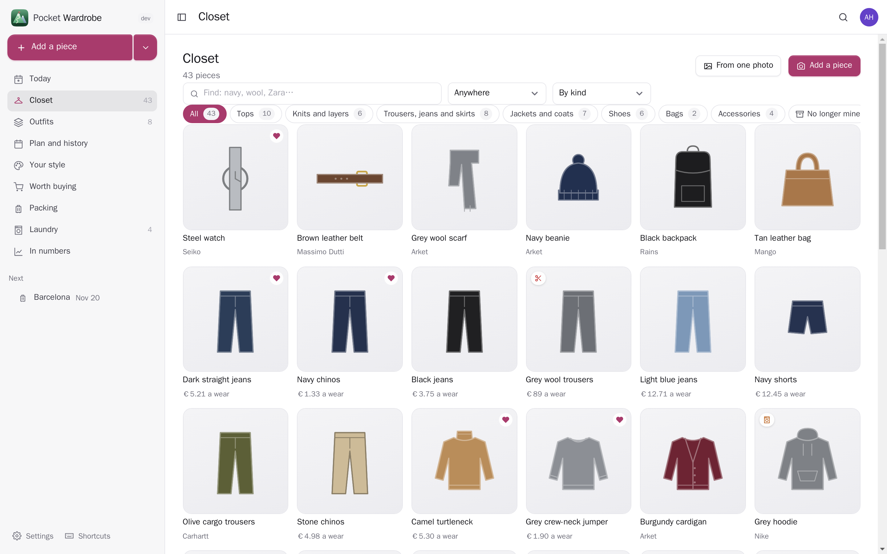</td>
    <td width="50%">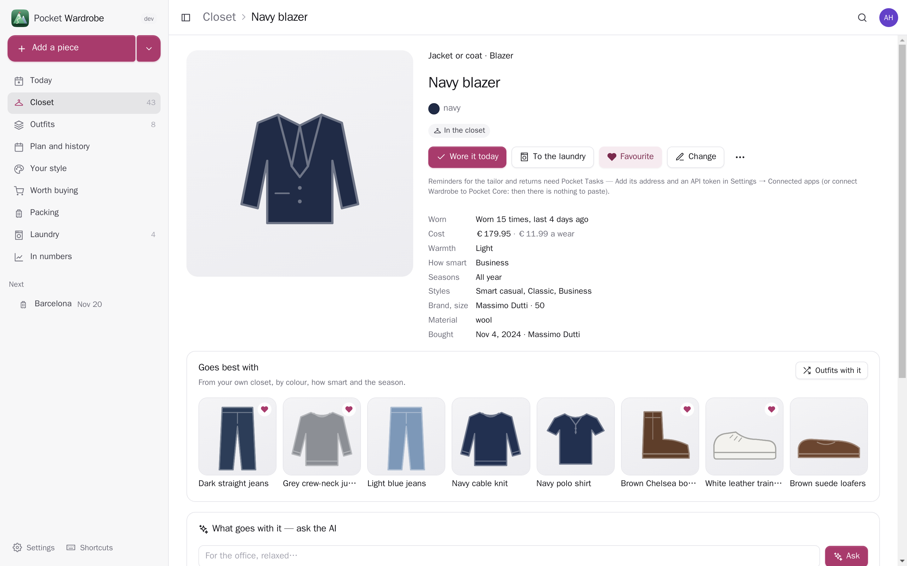</td>
  </tr>
  <tr>
    <td align="center"><sub>The closet: every piece as its photo (or a drawing in its colour), by kind, with the laundry and the tailor marked.</sub></td>
    <td align="center"><sub>A piece: how often worn and what it cost each time, what it goes best with from your own closet.</sub></td>
  </tr>
  <tr>
    <td width="50%">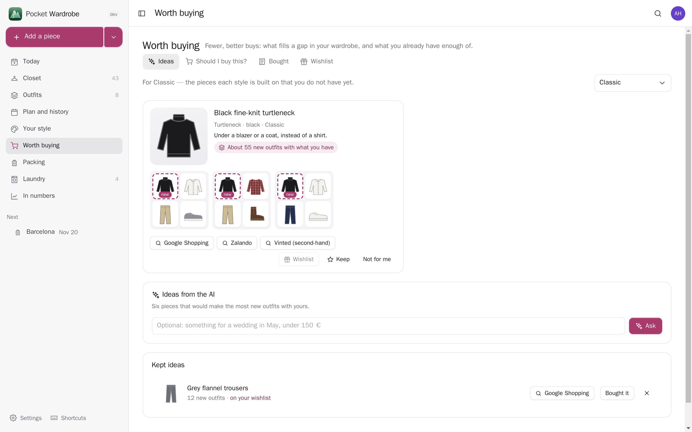</td>
    <td width="50%">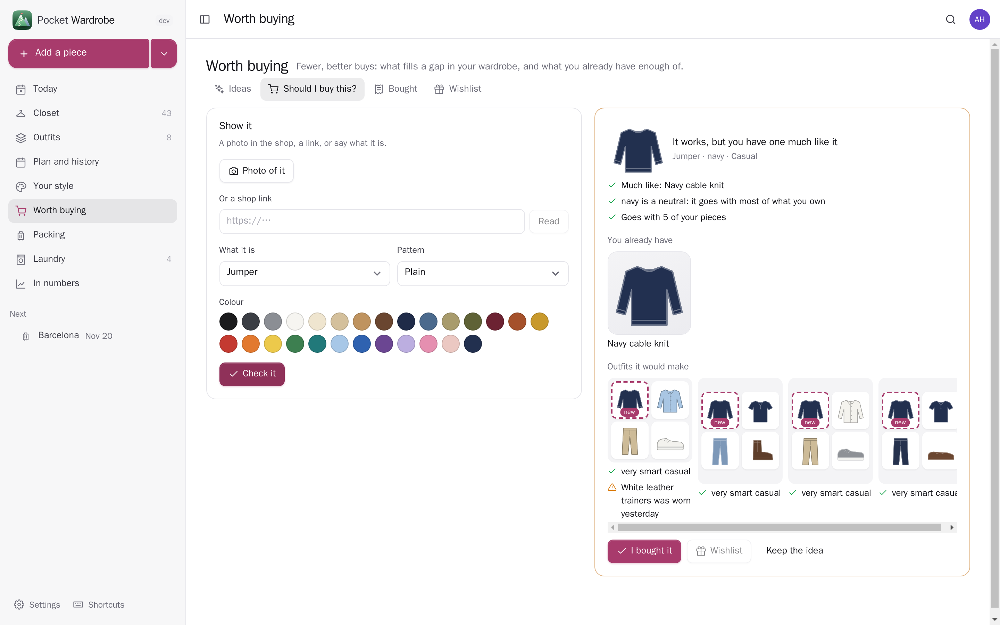</td>
  </tr>
  <tr>
    <td align="center"><sub>Worth buying: what your style is missing, drawn, with the outfits it makes with what you have and shop searches.</sub></td>
    <td align="center"><sub>“Should I buy this?” from a photo, a shop link or a few words: twins you already own, and the outfits it would make.</sub></td>
  </tr>
  <tr>
    <td width="50%">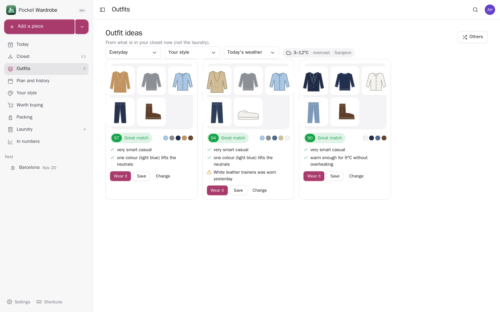</td>
    <td width="50%">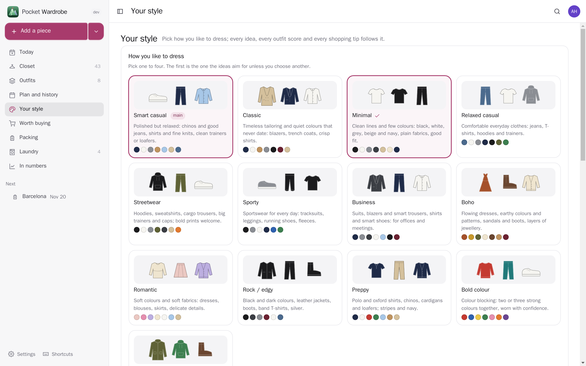</td>
  </tr>
  <tr>
    <td align="center"><sub>Outfit ideas for any occasion, style and weather, each scored with the reasons.</sub></td>
    <td align="center"><sub>Your style: thirteen ways to dress, your colours (the AI can read them from a selfie), “rate my look”.</sub></td>
  </tr>
  <tr>
    <td width="50%">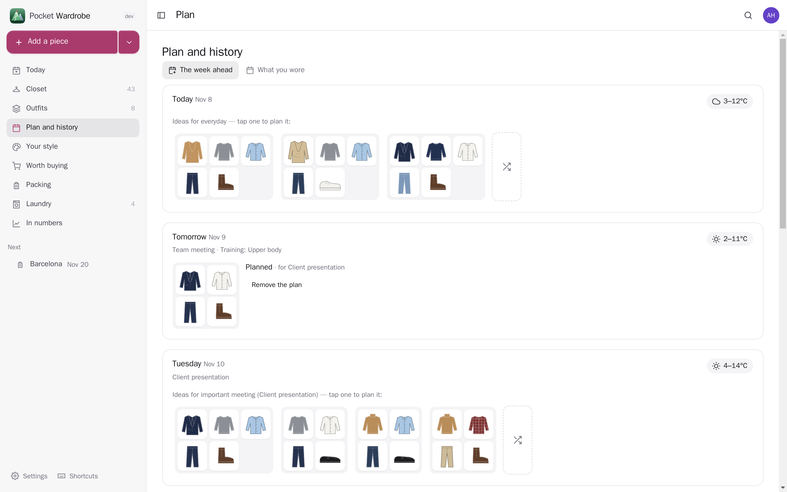</td>
    <td width="50%">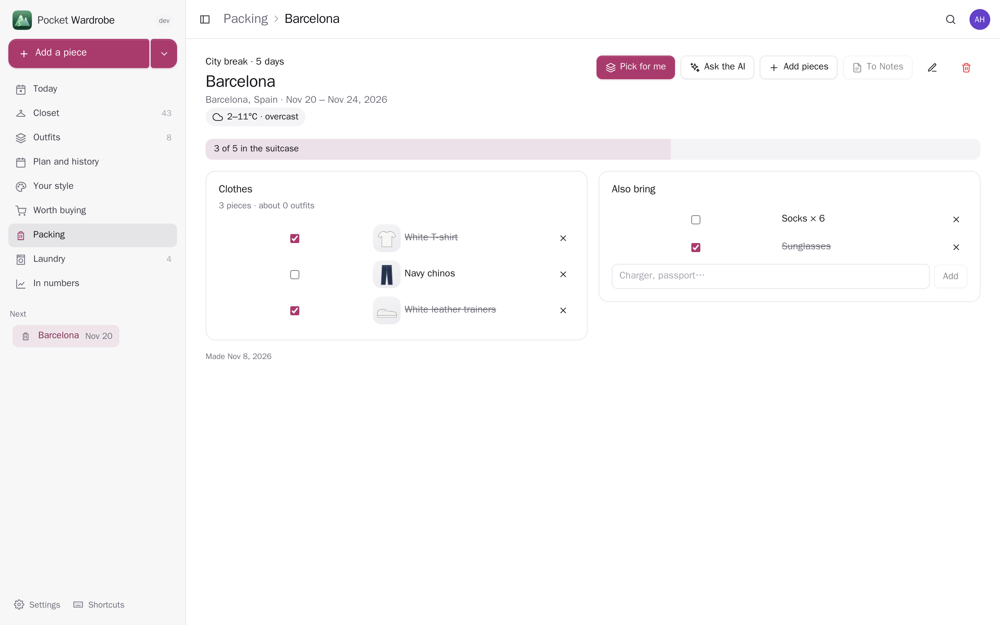</td>
  </tr>
  <tr>
    <td align="center"><sub>The week ahead with each day's forecast and events; tap an idea to plan it.</sub></td>
    <td align="center"><sub>Packing for a trip from Pocket Travel: a small set that mixes into many outfits, ticked off.</sub></td>
  </tr>
  <tr>
    <td width="50%">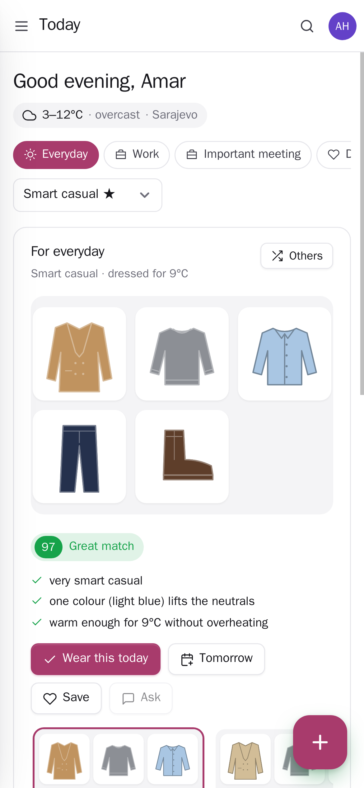</td>
    <td width="50%">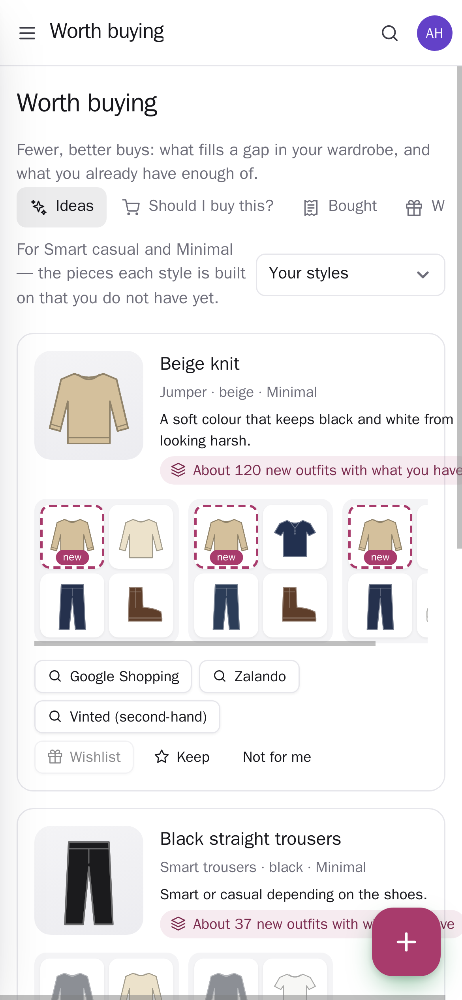</td>
  </tr>
  <tr>
    <td align="center"><sub>Today on the phone.</sub></td>
    <td align="center"><sub>Worth buying on the phone.</sub></td>
  </tr>
</table>

## What it does

- **The closet**: a photo (shrunk on your phone first) and the AI fills in the rest — kind, colours, pattern, material, seasons, how warm, how smart, which styles. Or several pieces from one photo of a rail or a bed. Tap the photo to take a colour from it. Without AI the colours come from the photo itself. No photo: a drawing in its colour and pattern.
- **Your style**: pick up to four of thirteen ways to dress (smart casual, classic, minimal, streetwear, sporty, business, boho, romantic, rock, preppy, bold colour, outdoorsy, relaxed). Colours you love and avoid. **Find my style** (the AI reads what you own and actually wear), **Find my colours** (seasonal colour analysis from a selfie in daylight, never kept), **Rate my look** (a mirror photo: what works, what to change, and what to swap from your own closet).
- **What goes with what** — a rule engine that works without any AI: colours (neutrals, one accent, neighbours and opposites on the wheel, light against dark), patterns, how smart against the occasion, warmth against the day's temperature, rain, season, your style and colours, what you wore yesterday and what is in the laundry. Every score comes with its reasons in plain words.
- **Today**: the weather where you are, what is on your calendar (a client meeting dresses you up, Friday's dinner too), a training day or a hike; one outfit big, others to swap to, “Wear this”, “Tomorrow”, “Ask in Chat”. **Style me**: tell the AI what the day needs, it picks from your clothes.
- **Outfits**: make one by tapping pieces (the score changes as you go), save the ideas you like, see the outfits a piece is in.
- **Plan and history**: the week ahead with each day's forecast; a month of what you wore, with the weather of the day.
- **Laundry and the tailor**: logging what you wore puts tops in the basket; pieces at the tailor, lent out or stored are left out of the ideas. Reminders for the tailor, dry cleaning and returns go to Pocket Tasks.
- **Worth buying**: the staples your styles are built on that you lack, each drawn, with *how many new outfits it makes* with what you have, those outfits, and searches in your shops (Google Shopping, Zalando, Vinted second-hand — change them in Settings). The AI's ideas for a wish and a budget. **Should I buy this?**: a photo in the shop, a shop link or a few words → the pieces you already own that are much like it, and the outfits it would make. **Bought**: clothing from Pocket Money and Pocket Parcels, one tap into the closet with its price.
- **Packing**: from a Pocket Travel trip (dates and the forecast there): a capsule that mixes into many outfits, extras (socks × days, swimwear, an umbrella when rain is due), or the AI's pick; ticked off as it goes in; a checklist in Pocket Notes.
- **In numbers**: how much of your wardrobe you wear, cost per wear (best value and worst), what has not been worn, your colours, days logged.
- **Everyone their own** on one box. **Messages** through Apprise, ntfy or a webhook: an outfit in the morning, tomorrow's weather in the evening, laundry day.

## Run it

```sh
docker run -d --name pocket-wardrobe -p 8080:8080 -v ./data:/data \
  -e BASE_URL=https://wardrobe.example.com -e SECURE_COOKIES=true \
  ghcr.io/abjelosevic88/pocket-homelab-wardrobe:latest
```

or `docker compose up -d` with [docker-compose.yml](docker-compose.yml). Open it, create the first account and photograph a piece. All options: [docs/configuration.md](docs/configuration.md). API: [docs/api.md](docs/api.md). Backups: [docs/backup.md](docs/backup.md).

## With Pocket Core

Set `CORE_URL` and `CORE_REGISTRATION_KEY` and Wardrobe joins the box: people sign in with Pocket Core, Pocket AI helps (photos too, from Pocket AI 0.87), and through app links your wardrobe reaches your own Pocket apps with nothing to paste:

| App | In Wardrobe | Without it | Scopes |
|---|---|---|---|
| Pocket Weather | dress for the day's weather; the forecast where a trip goes | Open-Meteo for your home town | `weather:read` |
| Pocket Calendar | the day's events decide what to dress for | pick the occasion yourself | `calendar:read` |
| Pocket Travel | pack for a trip: its dates and destination | type them | `trips:read` |
| Pocket Trails | dress in layers on a hike day | — | `trails:read` |
| Pocket Fitness | pack the gym clothes on a training day | — | `fitness:read` |
| Pocket Wishlist | ideas onto your wishlist; shop pages read for “should I buy this?”; your clothing wishes checked | read shop pages directly | `wishes:read`, `wishes:write` |
| Pocket Money | clothing purchases into the closet with their price | type the price | `transactions:read` |
| Pocket Parcels | clothes on their way, with return deadlines | — | `parcels:read` |
| Pocket Tasks | the tailor, dry cleaning, returns | — | `tasks:write` |
| Pocket Chat | “what do you think?” with the outfit's picture | — | `chat:read`, `chat:write` |
| Pocket Notes | a packing list as a checklist | — | `notes:write` |

**Nothing depends on another app.** Each app's state is checked per person, and what needs it is shown greyed out with one line saying why and what to do, never hidden.

Other apps use your wardrobe through `wardrobe:read` and `wardrobe:write`: Pocket AI tells you what to wear and logs an outfit when you ask, Pocket Day can write what you wore into your journal (`GET /day/{date}`), Pocket Search finds your pieces and outfits. Events on the bus — `wardrobe.item_added`, `wardrobe.outfit_saved`, `wardrobe.outfit_planned`, `wardrobe.outfit_worn`, `wardrobe.laundry_full`, `wardrobe.idea_saved` — start flows in Pocket Flows. Without Core every connection can be made directly with a URL and a token, and the AI can be your own OpenAI-compatible key (photos included).

## Develop

```sh
make dev     # API on :8080 with demo data + Vite on :5173
make test    # go vet, go test, tsc
make         # web + binary
```

`node scripts/screenshots.mjs` takes the screenshots above from a demo instance and fails on any browser error. MIT licensed.
